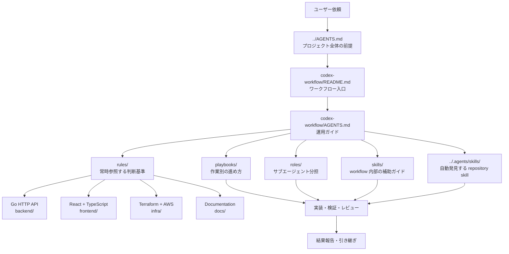
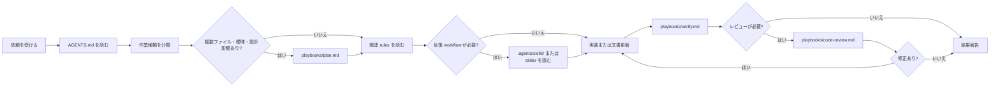

# devlab-board Codex Workflow

このディレクトリは、Codex で devlab-board の開発と運用を管理するための軽量なプロジェクトワークフローです。再利用パッケージではないため、生成された依存関係、スクリーンショット、関係のない言語ルール、ローカル環境の成果物は置きません。

## 対象範囲

- Go HTTP API のバックエンド開発
- Vite + React + TypeScript のフロントエンド開発
- Terraform による AWS IaC
- EC2 Auto Scaling、Serverless、ECS Fargate の構成比較
- docs 配下の設計、DB、運用、実装メモの作成・更新
- GitHub PRを取得・レビューし、COMMENTレビューを投稿するrepository skill
- 小規模から大規模まで、架空の業務要件も扱う基本設計・詳細設計の演習用repository skill
- 境界が明確なサブエージェント作業向けの短いロール
- 計画、実装、検証、レビュー、ドキュメント、リリース準備向けの短いプレイブック
- Sol と Luna の担当分担、検証結果から修正へ戻る機能開発ループ

## ディレクトリ構成

```text
codex-workflow/
|-- AGENTS.md
|-- README.md
|-- rules/
|-- playbooks/
|-- roles/
`-- skills/

.agents/
`-- skills/
    |-- design-practice/
    |-- feature-development/
    `-- pr-review/
```

## アーキテクチャ

`codex-workflow` はアプリケーションコードを直接生成する仕組みではなく、Codex が作業前に読む判断基準と手順をまとめた運用レイヤーです。



### 各要素の役割

- `../AGENTS.md`: devlab-board 全体の前提、技術スタック、制約、検証方針。
- `AGENTS.md`: `codex-workflow/` 自体の管理運用ルール。
- `rules/`: Go、React、Terraform、AWS、documentation、security、testing などの継続的な判断基準。
- `playbooks/`: 計画、機能実装、ドキュメント運用、検証、レビュー、インフラ変更、フロントエンドリリースの手順。
- `roles/`: サブエージェントに渡すときの責務境界。
- `skills/`: Go HTTP API、React TypeScript、Terraform AWS、documentation workflow のworkflow内部向けガイド。
- `../.agents/skills/pr-review/`: GitHub PR URL、PR、ブランチ差分、実装差分を固定観点でレビューし、GitHub PRではCOMMENTレビューを投稿するrepository skill。
- `../.agents/skills/design-practice/`: 現行アプリや架空の業務要件を題材に、規模に応じた基本設計と詳細設計を段階的にレビューするrepository skill。
- `../.agents/skills/feature-development/`: 機能開発の反復入口。詳細は `playbooks/agent-loop.md` に集約する。

## 機能開発ハーネス

`playbooks/agent-loop.md` に Sol / Luna のモデル指定、サブエージェントへの引き渡し項目、受け入れ条件から検証・修正までのループを定義する。Sol が要件定義、設計、アーキテクチャ、レビューと統合を担当し、Luna が実装、定型作業、確定した Playwright E2E ケースを担当する。`roles/e2e-tester.md` は E2E 担当の境界を示す。E2E の実行方法は `../frontend/README.md` を参照する。

モデルはサブエージェント起動時に明示する。role 文書だけで実行モデルが自動的に切り替わるわけではない。受け入れ条件が未達なら原因を特定して同じ担当へ戻し、検証結果を更新する。

## ワークフロー構成

通常の開発では、まずプロジェクト前提を確認し、作業種類に合う playbook と rule を読み、必要な場合だけ role や skill を追加で使います。



## 使い方

1. まず `../AGENTS.md` を読む。
2. タスクに合うルールまたはプレイブックだけを読む。
3. サブエージェントを使うときだけ `roles/` を選ぶ。
4. repositoryから直接呼び出す反復作業は `../.agents/skills/`、workflow内部の補助ガイドは `skills/` に置く。
5. 新しい workflow ファイルは短く、プロジェクト固有に保つ。

## メンテナンスルール

- このスタックで使わないルールは削除する。
- 新しいルールを増やす前に、既存ルールの更新で足りるか確認する。
- 繰り返し使う安定したrepository workflowは `../.agents/skills/` に昇格する。
- `node_modules`、`dist`、Terraform state、ネストした `.git`、local logs、ビルド成果物は commit しない。
