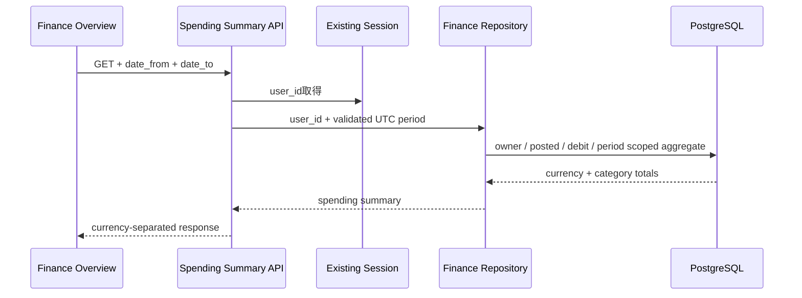

# Finance Spending Summary API Contract

## 1. 目的

現在のsession userに所属する指定期間の確定支出を、通貨とカテゴリーごとに集計する契約を定義する。既存の残高Summaryから分離し、一方の取得障害で他方を表示不能にしない。

## 2. Endpoint

```http
GET /api/finance/spending-summary?date_from=2026-08-01&date_to=2026-08-31
```

- 既存のserver-side session cookieを必須とする。
- clientからuser IDを受け取らず、sessionの内部 `user_id` で絞り込む。
- queryは単一値とし、同じkeyの重複、未定義key、明示的な空文字は不正とする。

## 3. Query contract

| query | 必須 | 制約 |
| --- | --- | --- |
| `date_from` | Yes | `YYYY-MM-DD`。UTC暦日の開始を含む |
| `date_to` | Yes | `YYYY-MM-DD`。UTC暦日の終了を含む |

- `date_from <= date_to` を必須とする。
- 期間は両端を含めて最大366日とする。
- SQLでは `date_to` の翌日未満へ変換する。
- 取引日時は既存取引APIと同じ `COALESCE(posted_at, authorized_at)` を使う。
- ユーザーtimezone設定がない初版ではUTCを明示する。

## 4. 集計contract

- `direction = debit` かつ `status = posted` の取引だけを確定支出として集計する。
- `pending`、`reversed`、`credit` は含めない。
- 金額は `currency + category` 単位で集計し、異なる通貨を換算・加算しない。
- category未設定は `category: null` のグループとして残す。
- 通貨はcode昇順、同一通貨内は金額降順、同額はcategory masterの表示順とcode順で安定させる。
- `asOf` は集計対象になった取引の `updated_at` 最大値とし、対象0件では `null` とする。
- `SUM(bigint)` は10進文字列で返し、Goの `int64` やJSON numberへ縮小しない。

## 5. Success response

```json
{
  "spendingSummary": {
    "dateFrom": "2026-08-01",
    "dateTo": "2026-08-31",
    "timezone": "UTC",
    "currencies": [
      {
        "currency": "JPY",
        "totalAmountMinor": "18400",
        "categories": [
          {
            "category": {
              "code": "groceries",
              "label": "食料品"
            },
            "amountMinor": "12400",
            "transactionCount": 3
          },
          {
            "category": null,
            "amountMinor": "6000",
            "transactionCount": 1
          }
        ]
      }
    ],
    "asOf": "2026-08-11T02:00:00Z"
  }
}
```

- 対象0件は `currencies: []`、`asOf: null` とする。
- 割合は浮動小数点で返さず、frontendが通貨ごとの合計とカテゴリー金額から算出する。

## 6. Error contract

| 条件 | HTTP status | code |
| --- | ---: | --- |
| 必須期間の欠落、未知・重複・空query、不正日付、逆転、366日超 | `400` | `finance_spending_summary_invalid_query` |
| sessionなし | `401` | `unauthorized` |
| DB取得失敗 | `500` | `finance_spending_summary_unavailable` |

- validation errorはSQLや内部日時表現を返さない。
- server logへカテゴリー別金額、user ID、期間値、金融response bodyを出さない。

## 7. データフロー



## 8. 対象外

- account filter、複数カテゴリーfilter。
- pending支出の見込み表示。
- ユーザーtimezone、通貨換算。
- category編集、provider mapping。
- chart、期間選択UI。

## 9. 更新履歴

| 日付 | 内容 |
| --- | --- |
| 2026-09-24 | Slice 4Aの支出集計API契約を初版作成 |
